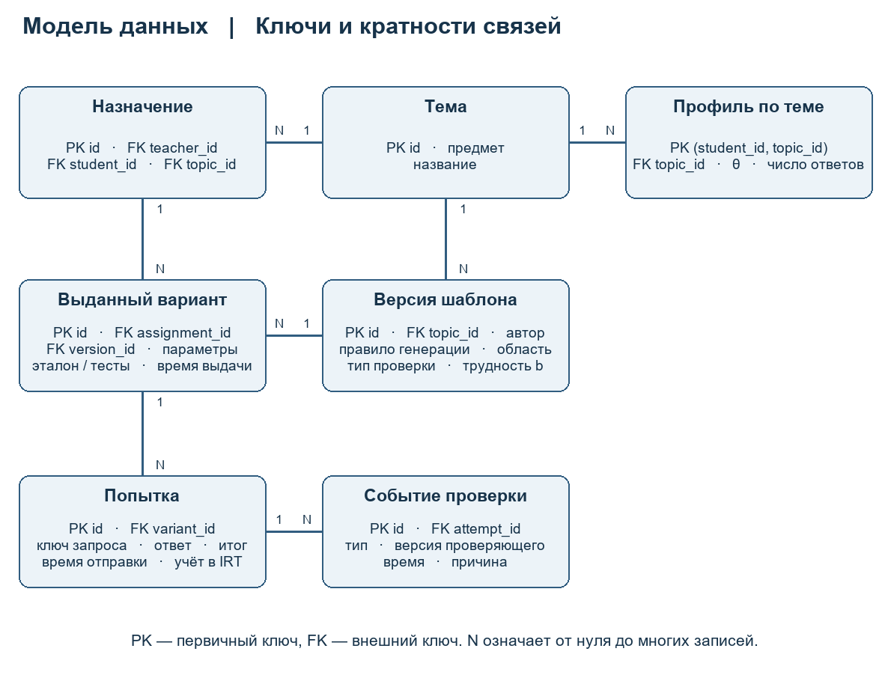
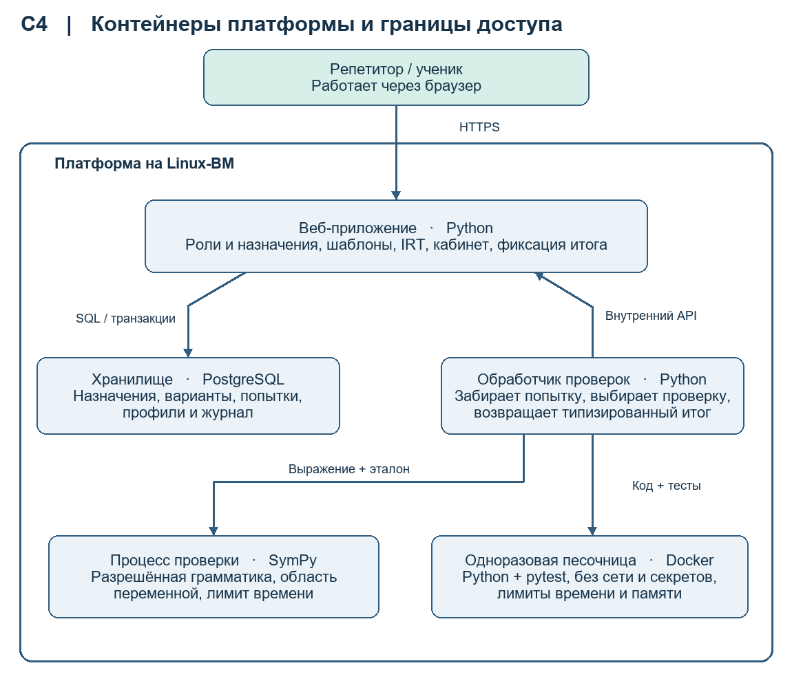
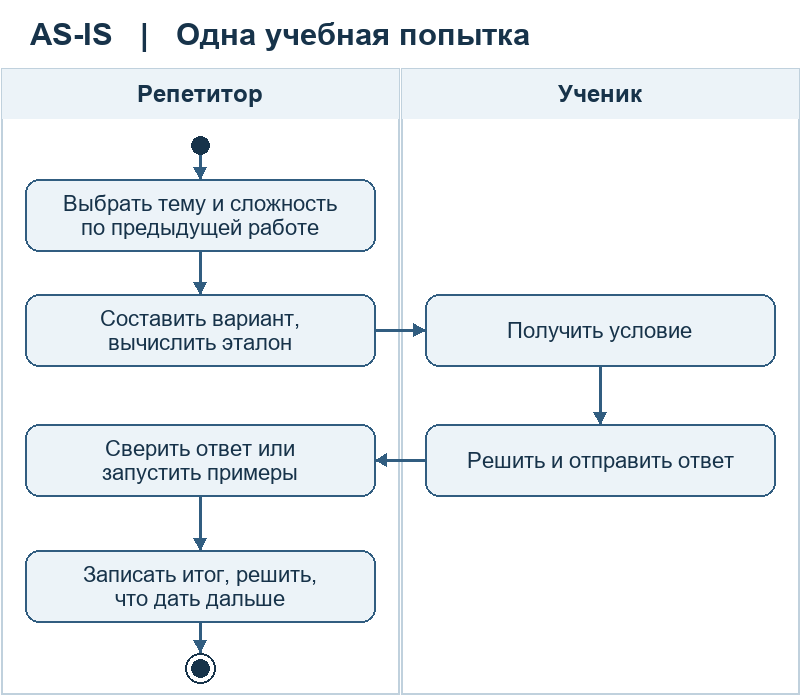
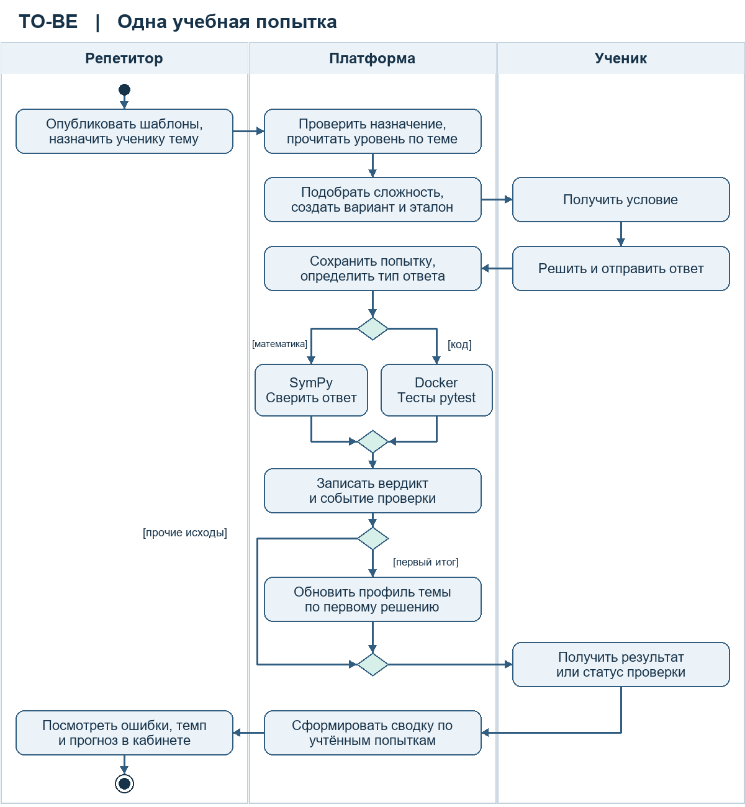

# Лабораторная работа № 3. Проектирование информационной системы

**Тема ВКР.** Разработка интеллектуальной образовательной платформы-конструктора с адаптивной генерацией учебных материалов и автоматической проверкой решений для подготовки к экзаменам и олимпиадам.

**Автор.** Забродский Александр Владимирович, группа К3422. Работа индивидуальная.

## 1. Предметная область и требования

Репетитор ведёт нескольких учеников, которые проходят одну тему в разном темпе. Например, после занятия по квадратным уравнениям одному ученику нужно закрепить разложение на множители, другому уже можно предложить уравнение с дробными коэффициентами. Сегодня преподаватель выбирает сложность, составляет варианты и проверяет ответы. Для следующего занятия ему приходится восстанавливать по переписке или записям, где ученик ошибался и сколько времени занимала работа.

В проектируемой системе репетитор определяет тему, правила генерации, допустимые ответы и критерии проверки. Платформа выдаёт индивидуальный вариант, проверяет попытку и обновляет профиль ученика. В первую версию входят задания ОГЭ и ЕГЭ по математике с кратким ответом и задачи на Python, в том числе олимпиадные с проверкой по тестам. Оценивание развёрнутых доказательств и геометрических построений остаётся за границами первой версии.

### Функциональные требования

| ID | Что должна делать система | Приёмочная проверка |
|---|---|---|
| FR-01 | Позволять репетитору публиковать версию шаблона с темой, трудностью, параметрами и правилом проверки, затем назначать тему ученику. | Опубликовать две версии. У ранее выданного варианта сохраняются исходные условие и эталон. Новая выдача использует действующую версию. |
| FR-02 | Выбирать шаблон по уровню ученика в назначенной теме и генерировать вариант с допустимыми параметрами и соответствующим им эталоном или тестами. | На банке с известными трудностями проверить выбор по формуле из раздела 5. Для граничных значений параметров пересчитать эталон вручную. |
| FR-03 | Проверять числа, выражения и уравнения с учётом допустимой области и типа ответа. | На действительной оси засчитать эквивалентные уравнения, проверить лишний корень и потерю точки области определения. Примеры приведены в разделе 4. |
| FR-04 | Проверять программу на Python по тестам конкретного варианта и различать неверный ответ, превышение лимита решения и технический сбой проверки. | Отправить верную программу, программу с ошибкой на граничном тесте и программу с превышением времени. Отдельно прервать обработчик и проверить статус повтора. |
| FR-05 | Показывать ученику результат и однократно обновлять уровень по первой завершённой учебной попытке для варианта. | Верный ответ повышает уровень, неверный снижает. Повторная отправка и сбой инфраструктуры сохраняют предыдущее значение. |
| FR-06 | Показывать репетитору долю ошибок по темам, динамику времени ответа и ориентировочный балл для заданной структуры экзамена. | На учебной истории сверить доли и интервалы с ручным расчётом. При отсутствии ответов по обязательной теме показать «недостаточно данных». |

### Нефункциональные требования

| ID | Проектное ограничение | Приёмочная проверка |
|---|---|---|
| NFR-01 | Ученик видит только свои варианты и результаты. Репетитор видит данные учеников по своим назначениям. Эталоны и закрытые тесты доступны только серверным компонентам и автору шаблона. | Под двумя учётными записями запросить свой и чужой вариант, проверить отказ в чужом запросе и состав ответа ученику. |
| NFR-02 | Каждая проверка кода выполняется в отдельном контейнере без сети, секретов приложения и доступа к БД. Предлагаемые лимиты для пилотного банка составляют 3 с на запуск решения и 128 МиБ памяти. | Проверить конфигурацию контейнера, завершение при превышении лимита и удаление контейнера после проверки. |
| NFR-03 | Повтор доставки результата после перезапуска обработчика сохраняет единственный зачтённый результат и согласованный профиль. | Дважды, в том числе одновременно, доставить итог одной попытки. Сверить число обновлений, событий завершения и изменение уровня с одиночной доставкой. |
| NFR-04 | По идентификатору попытки должна восстанавливаться история проверки вплоть до версии шаблона, параметров, эталона, версии проверяющего модуля и времени результата. | Из журнала выбрать попытку, восстановить входные данные и повторить проверку зафиксированной версией модуля. |

## 2. Обзор нотаций и видов диаграмм

| Нотация или вид диаграммы | Что описывает | Чем полезна при проектировании платформы |
|---|---|---|
| BPMN | Процесс с участниками, событиями, задачами и обменом сообщениями | Позволяет отдельно показать ожидание ответа ученика и обработку технического сбоя. |
| IDEF0 | Функцию, её вход, выход, управление и механизм выполнения | Различает ответ ученика как вход, критерий оценивания как управляющее правило и проверяющий модуль как механизм. |
| ER-модель | Сущности, ключи, связи и их кратность | Показывает, как несколько попыток связаны с одним вариантом и какой эталон действовал при выдаче. |
| DFD | Потоки данных между участниками, процессами и хранилищами | Позволяет проследить разные маршруты публичного условия и закрытых тестов. |
| UML, диаграмма деятельности | Действия, их исполнителей, порядок и ветвления | Позволяет сопоставить ручную и автоматизированную подготовку задания по одним и тем же этапам. |
| UML, диаграмма последовательности | Сообщения между участниками во времени | Уточняет, когда зафиксирована попытка и в какой момент обработчик может повторно доставить результат. |
| UML, диаграмма состояний | Состояния одного объекта и допустимые переходы | Помогает определить, из каких состояний попытку можно вернуть в очередь. |
| C4, диаграмма контейнеров | Исполняемые приложения, хранилища, их обязанности и связи | Позволяет увидеть, какие процессы имеют доступ к данным и где проходит граница выполнения ученического кода. |

## 3. Выбор нотаций для ВКР

| Выбранная модель | Проектный вопрос | Требования и способ проверки по модели |
|---|---|---|
| UML, деятельность | Кто выполняет каждый шаг от выбора темы до решения о следующем задании? | FR-01–FR-06, NFR-03. Дорожки показывают передачу работы между ролями, две ветви проверки сходятся перед фиксацией результата. Обновление профиля имеет отдельное условие. |
| ER-модель | Как связать попытку с версией условия и исключить двойной учёт? | FR-01, FR-02, FR-05, FR-06, NFR-01, NFR-03, NFR-04. Ключи задают путь от события до варианта, назначения, ученика и темы. |
| C4, контейнеры | Где проверяется доступ и какой процесс вправе запускать решение? | FR-03–FR-06, NFR-01–NFR-04. По границам процессов проверяются маршрут результата, изоляция исполнения и единственная точка записи итогов. |

## 4. Модели системы

### 4.1. Данные и воспроизводимость проверки

Единица выдачи в модели данных на рисунке 1 объединяет назначение, конкретную версию шаблона и фактически выбранные параметры. Например, из правила «при заданных целых корнях построить квадратное уравнение» при корнях 2 и 3 получается условие (x² − 5x + 6 = 0). Сохранение параметров и эталона позволяет разобрать спорную проверку после редактирования шаблона.

*Рисунок 1. Основные сущности, первичные и внешние ключи.*

Ученик и репетитор ссылаются на учётные записи. Эти ссылки обозначены полями в сущностях, а справочник пользователей опущен для читаемости. При выдаче приложение проверяет, что тема версии совпадает с темой назначения. После публикации версия неизменяема. Для математического шаблона она фиксирует также тип ответа и область переменных. Для программного задания вариант содержит ссылку на неизменяемый комплект тестов.

Ограничение уникальности пары «вариант, ключ запроса» защищает от двойной отправки одной формы. У разных осознанных попыток ключи различаются. Частичный уникальный индекс по варианту для записей с признаком «учтена в IRT» допускает только одну такую запись. Веб-приложение в одной транзакции блокирует строку варианта и профиль, фиксирует итог, добавляет событие завершения и при первой учебной оценке обновляет уровень. Повтор доставки сверяется с уже сохранённым итогом. Это связывает FR-05 и NFR-03 на уровне хранения.

Для кабинета доля ошибок равна отношению числа неверных первых оценённых попыток к числу всех первых оценённых попыток по теме. Время ответа отсчитывается от выдачи до первой отправки, поэтому включает возможные перерывы ученика. Для динамики показывается медиана этого интервала за неделю и число наблюдений. Длинный интервал сам по себе не свидетельствует о пробеле в знаниях.

### 4.2. Архитектура и маршруты проверки

На рисунке 2 показано размещение первой версии на одной виртуальной машине. Браузер обращается к веб-приложению. Только приложение читает назначения и пишет итог в PostgreSQL. Обработчик получает ожидающую попытку и передаёт итог через внутренний API. Такое разделение позволяет заменить проверяющий модуль без изменения правил доступа к кабинету.

*Рисунок 2. Диаграмма контейнеров C4. Стрелки показывают инициатора обращения.*

**Математика.** Разбор допускает только грамматику, объявленную в шаблоне. Для точных чисел сравниваются значения, для выражений проверяется совпадение областей и значений на области задания, для уравнений сравниваются множества решений. Например, уравнения (2x=4) и (x-2=0) эквивалентны над действительными числами, а у (x²=4) есть дополнительный корень −2. Выражения ((x²−1)/(x−1)) и (x+1) различаются областью определения, если шаблон заранее не исключил 1. Если SymPy не может установить эквивалентность в пределах лимита, попытка получает статус «требуется проверка преподавателя». До решения преподавателя уровень не меняется.

**Информатика.** Обработчик получает код и ссылку на тесты версии, запускает проверку в одноразовой песочнице и преобразует результат в учебный вердикт или технический статус. Доверенная обвязка pytest сравнивает результаты с эталонами вне процесса ученической программы. Программе передаётся вход текущего теста, а в кабинет ученика возвращается разрешённая обратная связь. Тайм-аут работающего решения считается учебным исходом, недоступность обработчика переводит попытку в очередь повторной проверки. Код запускается от непривилегированного пользователя без сетевого интерфейса для внешних соединений, сокета Docker и каталогов хоста.

**Доступ.** Перед выдачей, отправкой и чтением отчёта сервер сверяет пользователя с назначением. Внутренний API доступен только обработчику с сервисными полномочиями. Ученический процесс получает минимум данных для выполнения одного теста. Граница песочницы отражает NFR-02, а запись результата через приложение сохраняет единую транзакцию для NFR-03 и NFR-04.

## 5. AS-IS и TO-BE

Обе диаграммы деятельности охватывают одну учебную попытку от выбора темы до просмотра результата. В ручном сценарии на рисунке 3 репетитор дважды возвращается к индивидуальной работе ученика, сначала при подготовке варианта, затем при проверке и записи результата. Схема описывает исходный рабочий сценарий. Продолжительность операций предстоит измерить при апробации.

*Рисунок 3. AS-IS. Зоны ответственности репетитора и ученика.*

На рисунке 4 репетитор публикует правила для серии вариантов. При каждой следующей выдаче платформа использует уже опубликованный шаблон. До отправки ответа система фиксирует условия конкретного варианта, после проверки связывает результат с профилем и кабинетом. Просмотр сводки преподавателем возможен позднее.

*Рисунок 4. TO-BE. Тип задания определяет способ проверки, итог попытки определяет возможность обновления профиля.*

**Выбор сложности.** При первом назначении оценка уровня по теме θ равна нулю, начальную трудность шаблона b задаёт репетитор. По модели Раша вероятность верного ответа равна (P = 1/(1 + exp(b − θ))). Для выдачи выбирается доступный шаблон с минимальным значением |P − 0,70|. Например, при θ = 0 для трудностей −1 и +1 получаются вероятности около 0,73 и 0,27. Платформа выберет первый шаблон. После первого оценённого ответа уровень обновляется по правилу θ′ = θ + 0,4·(r − P), где r равен 1 для верного ответа и 0 для неверного. При верном ответе в этом примере θ′ ≈ 0,11. Целевая вероятность и шаг взяты из демонстрационной модели проекта. Для пилота трудность версии фиксируется при публикации, чтобы ответы одного ученика не меняли условия сравнения для остальных.

**Переход к прогнозу.** Для каждого задания выбранной экзаменационной спецификации репетитор указывает тему, трудность и максимальный первичный балл. Для заданий с бинарной проверкой кабинет суммирует произведения максимального балла на вероятность решения. Если модель покрывает лишь часть экзамена, рядом с оценкой указывается охваченный блок и его максимум. Например, две однобалльные задачи с вероятностями 0,73 и 0,27 дают ожидаемый результат 1 из 2. До накопления ответов по каждой теме блока прогноз скрыт. Точность прогноза предстоит оценить на независимых контрольных работах.

| Участок процесса | AS-IS, рисунок 3 | TO-BE, рисунок 4 | Что измерить на пилоте |
|---|---|---|---|
| Подготовка домашней работы | Репетитор составляет условие и эталон для каждого ученика. | Репетитор один раз задаёт правило, платформа генерирует варианты. | Минуты на одинаковое число вариантов с учётом времени создания шаблона. |
| Проверка | Репетитор проверяет каждую работу. | Тип ответа определяет маршрут SymPy или pytest. Неоднозначный математический ответ поступает репетитору. | Время проверки, доля совпадений с ручной оценкой, ложных зачётов, ложных отказов и передач на ручную проверку. |
| Следующая выдача | Сложность выбирается по записям о предыдущей работе. | Платформа повторяет подбор с обновлённым θ по теме. | На имитационных учениках измерить ошибку оценки θ и число заданий до заданной точности. В пилоте сравнить адаптивный и фиксированный порядок выдачи. |

## 6. Выводы

Три модели связывает выданный вариант. В процессе он появляется до отправки ответа, в базе хранит параметры и версию шаблона, а проверяющий модуль получает через него эталон или комплект тестов. Благодаря этой связи можно восстановить причину вердикта даже после изменения банка заданий.

При проектировании выявились два условия корректного адаптивного подбора. Технический сбой следует отделять от неверного решения, а одна выдача может изменить уровень ученика только один раз. Развилка на диаграмме деятельности, уникальность зачтённой попытки в модели данных и транзакция фиксации результата в веб-приложении описывают одно правило на разных уровнях.

Ожидаемое улучшение для репетитора состоит в повторном использовании шаблонов и автоматической проверке типовых ответов. Величину экономии времени, точность проверки и пользу адаптации планируется оценить раздельно при апробации примерно с 10 репетиторами и 30 учениками. В рамках ЛР3 получены проектные модели и критерии проверки. Экспериментальные показатели относятся к следующему этапу ВКР.
